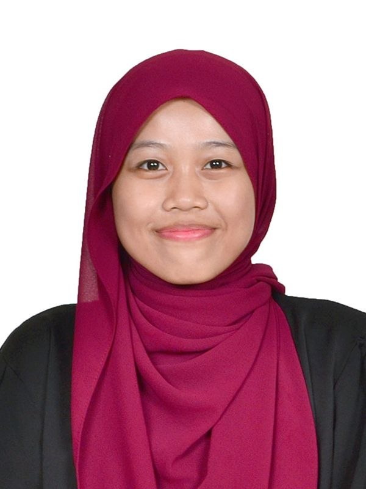

  

# Hi there, I'm Nur Syamimi Batrisya 👋

🎓 **Data Engineering Student @ Universiti Teknologi Malaysia (UTM)**  
🌱 Currently in my 1st year, building foundations in Data Engineering.

---

### 🚀 About Me
- 🔭 Learning programming basics, data structures, and database fundamentals.
- 🎯 Goal: To build efficient data pipelines and explore the world of data architecture.
- 💡 Interested in data processing, database management, and cloud basics.

---

### 📫 Connect with Me
- 💼 **LinkedIn:** https://www.linkedin.com/in/nur-syamimi-batrisya-supriyan-269b30372
- ✉️ **Email:** nursyamimibatrisya@graduate.utm.my

---
⭐️ *Building my data engineering journey step-by-step!*
